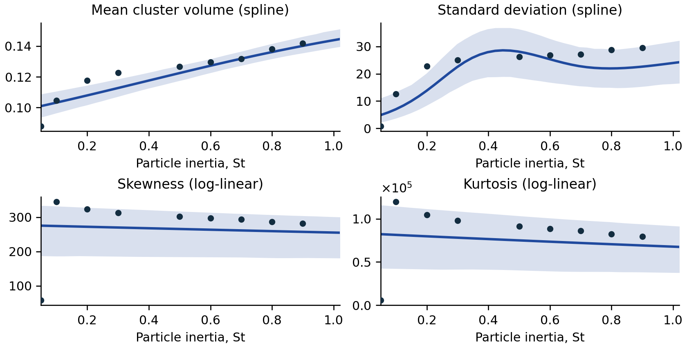
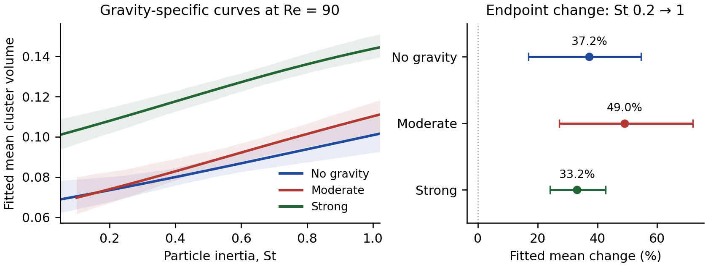

## 1. Introduction

Particles in turbulent flows can accumulate in clusters rather than remaining uniformly distributed. This affects collision and mixing processes relevant to rain formation. Direct numerical simulation (DNS) is expensive: the workshop reports about two days to four months per simulation at the illustrated resolutions, followed by additional cluster analysis [1]. A machine learning surrogate can approximate cluster-volume characteristics at new settings without repeating this computation, although its prediction uncertainty must be considered.

Our objectives are to predict the mean, standard deviation (SD), skewness and kurtosis of cluster volume and to investigate how turbulence, gravity and particle inertia relate to these summaries. The workshop’s curved profiles and differences between physical regimes (slide 34) motivate nonlinear terms and interactions. We compare models on predictive accuracy and interpretability, using flexible relationships where the data support them and simpler relationships where extra complexity does not improve prediction.

## 2. Methodology

### 2.1 Data preparation and transformations

We analyzed 89 labeled simulations and predicted 23 additional supplied settings. Reynolds number Re (90, 224, 398) and Froude number Fr (∞, 0.3, 0.052) were treated as categorical predictors because each has only three observed levels. Re measures turbulence intensity; smaller Fr indicates stronger gravitational influence, and Fr = ∞ represents no gravity. The Re = 398, Fr = 0.3 combination is absent. Stokes number St measures particle inertia. Although observed at only 14 levels from 0.05 to 3, it was treated numerically to approximate smooth relationships and interpolate within supported ranges.

The supplied raw moments m~j~ = E(V^j^) were converted to the four summaries as follows:

μ = m~1~,   σ² = m~2~ − μ²,   σ = √(σ²);
γ = (m~3~ − 3μm~2~ + 2μ³)/σ³;
κ = (m~4~ − 4μm~3~ + 6μ²m~2~ − 3μ⁴)/σ⁴.

Skewness γ measures asymmetry, and κ is ordinary, not excess, kurtosis. All responses were positive and varied substantially in scale; mean and SD were right-skewed across simulations. Initial raw-scale linear fits produced negative mean predictions and patterned residuals. We therefore investigated log transformations. All raw-response spline candidates failed the requirement of finite, positive validation predictions. Supplementary Box-Cox estimates at the recommended regression designs ranged from −0.085 to 0.025; all approximate 95% profile intervals included zero, supporting a log transformation conditionally on these designs. Predictions were exponentiated and evaluated on the original scale.

### 2.2 Model specification

Natural cubic splines allow smooth nonlinear inertia relationships while retaining interpretable response curves. For each summary Y, we considered

h(Y) = α~g(Re,Fr)~ + f(St) + ε,   or   h(Y) = α~g(Re,Fr)~ + f~Fr~(St) + ε.

The intercept identifies one of eight observed Re-Fr regimes. We compared 2-4 spline degrees of freedom, shared or gravity-specific curves, and raw or log responses. Gravity-specific curves share their shape across Re within Fr. Natural splines have linear boundary tails on the modeled scale. We also compared a log-linear reference, f(St) = βSt; a quadratic St model; a GAM (basis size 5, REML); and 500-tree forests, tuning split predictors (1 or 2), node size (3 or 8), and response scale.



### 2.3 Validation and scientific inference

We compared all model families using identical five-fold partitions (seed 325), selected configurations by minimum original-scale MSE, and report RMSE. Knots and coefficients were learned within training folds; failed or nonpositive-prediction candidates were excluded. Final fits use all 89 observations. These reused CV selection scores are not independent test errors. Exponentiating a log fit yields a geometric-scale prediction without arithmetic-mean bias correction.

Scientific inference uses fitted regression curves and parameter contrasts, with 95% percentile intervals from 1,000 whole-row bootstrap resamples (seed 2026). All refits succeeded. These pointwise intervals assume independent, representative rows and omit model-selection and original-moment uncertainty; they are not prediction intervals. Residual patterns and influential observations were examined. Forests remain predictive alternatives, while scientific curves describe the interpretable regressions before the output check below.

## 3. Results

### 3.1 Predictive performance

| Model | Mean | SD | Skewness | Kurtosis | Kurtosis* |
|---|---|---|---|---|---|
| Log-linear | 0.011289 | 4.693 | 36.14 | 16,244 | 16,209 |
| Quadratic | 0.009161 | 2.994 | 36.44 | 16,310 | 16,409 |
| GAM | 0.009893 | 3.065 | 36.14 | 16,261 | 16,271 |
| Natural cubic spline | 0.003965 | 2.403 | 36.49 | 16,342 | 16,450 |
| Random forest | 0.010275 | 2.600 | 32.04 | 14,162 | 14,024 |

Table 1. Five-fold CV RMSE (original scale). Kurtosis is shown before and after the output check κ* = max(κ̂, γ̂² + 1), applied to held-out predictions. Bold marks column minima; compare models within columns.

Splines lower mean/SD RMSE by 65%/49% versus the log-linear reference, selecting gravity-specific shape with 2 degrees of freedom for mean and shared shape with 4 for SD. For skewness/kurtosis, log-linear models slightly outperform shared 2-degree-of-freedom splines. We recommend the simpler tail models; forests remain more accurate.

{width=100%}

Figure 1. Recommended regression fits at Re = 90, Fr = 0.052. Dots: observed summaries. Shading: approximate 95% pointwise fit intervals before the output check. Separate original-scale axes retain the low-St discrepancy.



### 3.2 Particle inertia and response differences

At fixed turbulence and gravity, the fitted mean increases throughout St = 0.2-1. Its endpoint increase is 37.2% without gravity, 49.0% under moderate gravity, and 33.2% under strong gravity (Figure 2). The respective bootstrap intervals for these proportional changes are 17.0–54.6%, 27.3–72.0%, and 24.1–42.7%. This supports a positive fitted association over the specified interval; it does not establish a universal law over all inertia values.

SD instead has a nonmonotonic fitted profile: it rises, falls, then rises again within this interval. Nevertheless, its endpoint is 73.2% higher at St = 1 than at 0.2 (interval 31.5–123.4%). The same proportional change across regimes is imposed by the shared log-scale spline, while absolute spreads differ. It is not eight independent confirmations of an identical physical response. Larger mean volume and greater spread describe larger, more variable cluster volumes, not necessarily greater particle concentration or a directly measured change in rainfall.

{width=100%}

Figure 2. Mean response at fixed Re = 90. Left: gravity-specific spline curves with pointwise 95% bands. Right: proportional changes from St = 0.2 to 1 with bootstrap intervals. Overlapping intervals are not a formal test of equality between gravity effects.

### 3.3 Gravity and turbulence interactions

The selected mean model permits gravity to change the inertia curve’s shape, not merely its height. Selection supports using this interaction for prediction within the candidate set; it does not establish statistical significance. In contrast, the SD model uses a shared inertia curve. This distinction illustrates why we select response-specific structures: the center and spread need not respond in the same way. Because group intercepts already encode joint Re-Fr differences, a shared St curve does not mean the model has no interactions at all.

At fixed St = 0.5, strong versus no gravity gives a fitted mean 46.8% higher at Re = 90 (interval 37.0–56.6%), approximately unchanged at Re = 224 (−0.4%; −9.6–9.9%), and 11.1% lower at Re = 398 (−18.0 to −3.1%). Thus, there is no single gravity-associated mean shift common to all turbulence settings. These are comparisons between curves at fixed inertia; they do not contradict a rise along each curve as inertia increases. Gravity also changes spread differently: the corresponding SD ratio is about 2.69 at Re = 224 (2.03–3.59), but 0.79 at Re = 398 (0.58–1.08), where the interval includes no change.

At St = 0.5 without gravity, increasing Re from 90 to 398 is associated with lower fitted mean and SD but higher skewness and kurtosis: location and spread can decrease while standardized tail measures increase. Physically, inertia governs how quickly particles respond to the flow, while gravity introduces settling. Their combined influence makes regime-dependent clustering plausible. However, DNS resolution and domain sizes also vary [1]. Without confirming volume normalization, between-regime contrasts should remain descriptions of the supplied simulation summaries rather than isolated causal effects of turbulence or gravity.



### 3.4 Tail behavior and diagnostic checks

The recommended log-linear models estimate decreases of 6.2% in skewness and 15.0% in kurtosis as St increases from 0.2 to 1, with bootstrap intervals of −9.8 to −0.5% and −20.7 to −5.6%. However, the spline sensitivity analysis gives intervals spanning zero. The directional evidence therefore depends on assuming a shared straight inertia effect on the log scale; it is not a robust physical law. At St = 0.5 and Re = 224, strong versus no gravity gives fitted ratios of 3.00 for skewness (2.84–3.17) and 8.89 for kurtosis (8.06–9.95), describing more asymmetric and heavier-tailed volumes in this regime.

The low-inertia mismatch remains visible. At Re = 90, Fr = 0.052, St = 0.05, tail predictions substantially exceed observations; Cook’s distances are 0.75 and 0.76. Removing this run solely for sensitivity changes the endpoint decreases from 6%/15% to 8%/18%. All final fits retain it. Gravity-specific splines did not improve tail CV errors. Replacing St with log(St) in log-linear and 2-4-degree-of-freedom spline candidates also failed to improve them under the same folds. Residual and normal-quantile plots still show misfit. More flexible models are not justified simply because one observation is poorly fitted.

## 4. Conclusion

This study shows how a surrogate can complement computationally expensive simulations while investigating particle-clustering relationships. Splines predicted mean and SD best, while forests predicted skewness and kurtosis more accurately. For interpretation, we recommend splines for mean/SD and simpler log-linear tail models: extra tail curvature did not improve prediction. The mean increased with inertia over St = 0.2-1, SD increased overall but nonmonotonically, and gravity associations depended on turbulence. Tail-direction conclusions were more sensitive to model assumptions. A prediction-first alternative uses the mean/SD splines and forests for the tails; our recommended pipeline has 12.8% higher skewness error and 15.6% higher checked-kurtosis error.

**Prediction consistency.** Independent tail fits can violate the necessary relation κ ≥ γ² + 1. We preserve predicted skewness and raise kurtosis only when required by this bound. Applied to held-out predictions, this check changes log-linear kurtosis RMSE from 16,244 to 16,209; lowering skewness instead slightly worsened its error. Four of 23 recommended test rows require kurtosis increases of 1.5–10.8%. All then pass this necessary check, but this does not certify a complete physically valid distribution. The check is an explicit prediction-stage adjustment, not an inferred physical mechanism.

These results should not be treated as definitive physical effects. Only 89 labeled runs, three Re/Fr levels and a missing regime limit coverage; four test settings also lie outside their regime’s observed St range. Categorical inputs do not support new Re/Fr levels, and boundary behavior does not validate extrapolation. For engineering collaborators, use the surrogate for screening within supported regimes and collect additional well-spread turbulence/gravity levels and low-inertia transition runs. Retain snapshot-level summaries, confirm volume normalization, and validate on independently generated simulations. Higher-Re extrapolation requires physical justification. The value of the analysis is both faster approximation and identifying where the available data leave scientific questions unresolved; the targeted model review and output check still need independent validation.

**Sources and reproducibility.** [1] Momenifar & Holt, *Data Analysis of Particle Clustering in Turbulence*, supplied Data_Expedition_F2026.pdf (slides labeled Fall 2020), especially slides 18, 31 and 34. [2] STA 325 assignment and rubric. [3] Team notebook, eva163x/turbulence-case-study, Rithika-modeling commit 81efbe4. The source package includes code, fold assignments, bootstrap outputs, sensitivity checks, unadjusted and adjusted predictions, and row-level flags; no hidden test labels were used.
